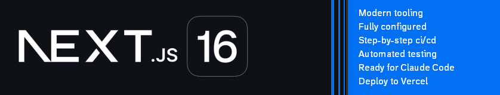
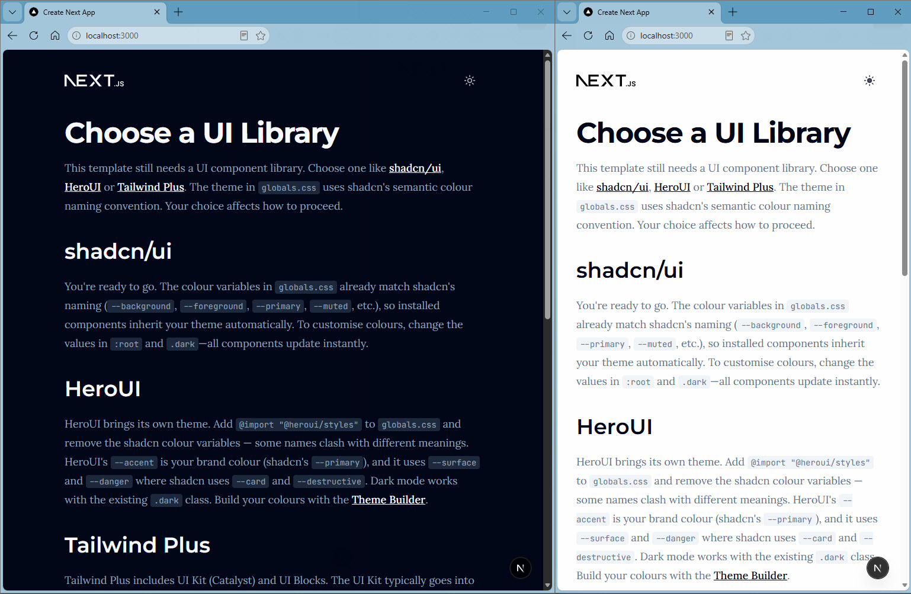

# Next.js 16 Template



*A Next.js 16.4 template. Lint, format, type and unit-test checks run on every commit, and end-to-end tests on every push. Every PR repeats these checks on GitHub and adds end-to-end tests against a Vercel Preview. A branch ruleset ([one-time setup](docs/project-setup.md)) blocks merging to `main` until they pass. Merging deploys to Vercel Production, where the end-to-end tests run again. Dependabot keeps dependencies current. Claude Code is set up, plugins included. [You choose the rest](#you-choose-the-rest): UI components, database, etc.*

<div align="left">
  <a href="https://nextjs-template-hello.vercel.app" target="_blank">
    
  </a>
  <p><em><a href="https://nextjs-template-hello.vercel.app">Template homepage</a> — deployed on Vercel</em></p>
</div>

## 🎯 Use This Template

**Prerequisites:** [Claude Code](https://code.claude.com), [Git](https://git-scm.com), [GitHub CLI](https://cli.github.com) (logged in via `gh auth login`) and [Node.js 24](https://nodejs.org) for Next.js. To check and install them, give Claude Code [this README](https://raw.githubusercontent.com/michellepace/nextjs-template/refs/heads/main/README.md) and ask it to install only the missing prerequisites.

<details>
<summary>(1) Get the Code — fresh start or keep history</summary>

Pick one, swapping `my-app` for your new repository name:

```bash
# Fresh start, no template history (same as the "Use this template" button)
gh repo create my-app --template michellepace/nextjs-template --public --clone
cd my-app
```

```bash
# Keep history: Claude can read the template's commits to answer "why was this done?"
git clone https://github.com/michellepace/nextjs-template.git my-app
cd my-app
git remote remove origin
gh repo create my-app --public --source . --push
git remote set-head origin --auto  # record main as default, as a clone does
```

Keep `--public` unless you have GitHub Pro — free accounts can't protect `main` on private repos.

</details>

<details>
<summary>(2) Install and Run — dependencies, test browsers, dev server</summary>

```bash
npm install                                         # Dependencies + git hooks
npx playwright install chromium webkit --with-deps  # Browsers for E2E tests
npm run dev                                         # Open http://localhost:3000 (Ctrl+C to stop)
```

</details>

<details>
<summary>(3) Set Up Claude Code — global tools and plugins</summary>

Install the tools Claude Code's TypeScript plugin and browser skill need:

```bash
# typescript-lsp plugin runs this. It then uses the project's TypeScript
npm install -g typescript-language-server

# Browser automation for Claude; refreshes the skill in .claude/skills/playwright-cli/
npm install -g @playwright/cli@latest
playwright-cli install --skills
```

Then run `claude` in the project folder, trust it, and accept the offer to install the plugins in [`.claude/settings.json`](.claude/settings.json). If you skipped the offer, run:

```bash
claude plugin marketplace add anthropics/claude-plugins-official --scope project
claude plugin marketplace add michellepace/my-claude-marketplace --scope project

claude plugin install typescript-lsp@claude-plugins-official --scope project
claude plugin install alwayson-misc@my-claude-marketplace --scope project
claude plugin install git-utils@my-claude-marketplace --scope project

claude plugin install mattpocock-skills@claude-plugins-official --scope project # enable
claude plugin disable mattpocock-skills@claude-plugins-official --scope project # disable again
```

- **mattpocock-skills** is disabled: its many skills fill the context window and trigger when you don't want them. Turn it on with `claude plugin enable mattpocock-skills@claude-plugins-official --scope project`.
- **[git-utils](https://github.com/michellepace/my-claude-marketplace/tree/main/plugins/git-utils)** is my own plugin and optional. Ask Claude to remove or disable it.

</details>

<details>
<summary>(4) Install Extensions — VS Code / Cursor</summary>

In VS Code or Cursor, install the extensions listed in [`.vscode/extensions.json`](.vscode/extensions.json). When the editor asks to use the workspace TypeScript version, click Allow — this turns on the Next.js editor checks.

Missed it? Open a `.tsx` file, press Ctrl+Shift+P and run **TypeScript: Select TypeScript Version** → **Use Workspace Version**.

</details>

<details>
<summary>(5) GitHub + Vercel Setup — deploys, CI, branch protection</summary>

Follow [`docs/project-setup.md`](docs/project-setup.md) to set up GitHub and Vercel.

</details>

<details>
<summary>(6) Housekeeping — make the Claude Code config yours</summary>

Modify [`.claude/CLAUDE.md`](.claude/CLAUDE.md), [`.mcp.json`](.mcp.json), and [`.claude/settings.json`](.claude/settings.json) (permissions and plugins) as preferred.

</details>

<details>
<summary>(7) Choose UI Library — shadcn/ui, HeroUI or Tailwind Plus</summary>

Choose one that supports Tailwind 4. [shadcn/ui](https://ui.shadcn.com/) (free) and [HeroUI v3](https://heroui.com/) (free) are both LLM friendly and use semantic tokens — which makes theming easy. shadcn is ubiquitous so theme it well to stand out — [tweak-cn](https://tweakcn.com/) and [theme-generator](https://shadcnstudio.com/theme-generator) are helpful. HeroUI is more visually distinct and extremely LLM friendly; it ships with agent skills too. [Tailwind Plus](https://tailwindcss.com/plus) (paid) offers components ([Catalyst](https://tailwindcss.com/plus/ui-kit)), assembled UI blocks, and full site templates, but doesn't include semantic tokens so centralised theming takes more manual work.

</details>

<details>
<summary>(8) Decide on Icons — each UI library ships its own</summary>

Each UI library above ships with icons — shadcn/ui uses [Lucide React](https://lucide.dev/guide/react/), Tailwind Plus (Catalyst) uses [Heroicons](https://heroicons.com/), HeroUI uses [Iconify](https://iconify.design/). All three let you swap to a different icon library.

</details>

<details>
<summary>(9) Replace Template Files — your pages, theme and fonts</summary>

Replace [`app/page.tsx`](app/page.tsx), [`app/layout.tsx`](app/layout.tsx), [`components/button.tsx`](components/button.tsx), [`app/globals.css`](app/globals.css) (centralised theming), [`app/fonts.ts`](app/fonts.ts), and [`components/theme-toggle.tsx`](components/theme-toggle.tsx) (use an icon).

</details>

## What's Installed?

For exact list see [`package.json`](package.json)

| Category | Tool | What it does |
| :------- | :--- | :----------- |
| Runtime | [Node.js 24 LTS](https://nodejs.org) | Pinned via [`.nvmrc`](.nvmrc); `engines` in [`package.json`](package.json) bounds it to the 24 line |
| Framework | [Next.js 16.4](https://nextjs.org) | Core webapp foundation — routing, rendering, API routes, optimisation, and builds |
| Language | [TypeScript 6](https://www.typescriptlang.org) | Static type checking with strict mode enabled — not 7 yet, which can't run the Next.js editor plugin |
| Styling | [Tailwind CSS v4](https://tailwindcss.com) | Utility-first CSS framework for rapid styling |
| | [next-themes](https://github.com/pacocoursey/next-themes) | Light/dark mode theming provider |
| Linting | [Biome](https://biomejs.dev) | Fast linter and formatter (replaces ESLint + Prettier) |
| | [markdownlint-cli2](https://github.com/DavidAnson/markdownlint-cli2) | Lints markdown files for consistent formatting |
| Testing | [Vitest](https://vitest.dev) | Fast unit test runner (Vite-native, Jest-compatible) |
| | [Playwright](https://playwright.dev) | E2E browser testing (Chromium, Mobile Safari) |
| | [Testing Library](https://testing-library.com) | React component testing utilities |
| Git Hooks | [Lefthook](https://lefthook.dev) | Runs checks on commit (lint, typecheck, unit tests) and push (build, E2E tests) |
| Optimisation | [React Compiler](https://react.dev/learn/react-compiler) | Automatic memoisation and performance optimisations |
| Analytics | [Vercel Speed Insights](https://vercel.com/docs/speed-insights) | Real user performance metrics viewable on Vercel |
| | [Vercel Web Analytics](https://vercel.com/docs/analytics) | Privacy-friendly visitor analytics viewable on Vercel |

## You Choose the Rest

You'll need:

- UI components (e.g. shadcn/ui, HeroUI v3, Tailwind Plus)
- Database/ORM (e.g. Neon or Supabase with Prisma or Drizzle. Or Convex - no ORM needed!)
- Authentication (e.g. Clerk, Supabase Auth, or Better Auth — open source, Vercel-owned)
- Validation (e.g. Zod, to check form and API data on the server)

Maybe:

- Forms (e.g. React Hook Form, for complex forms)
- State management (e.g. Zustand, Jotai, or React Context)

## This Repo Explained

<details>
<summary><b>Next.js Installation</b> — the <code>create-next-app</code> answers and updates</summary>

This template was initialised with the following options and then updated:

```bash
# Next.js installer
$ npx create-next-app@latest

Would you like to use TypeScript?      ✔️ Yes
Which linter would you like to use?    ✔️ Biome
Would you like to use React Compiler?  ✔️ Yes
Would you like to use Tailwind CSS?    ✔️ Yes
Would you like your code inside a src/ directory?  ❌ No
Would you like to use App Router? (recommended)    ✔️ Yes
Would you like to use Cache Components?            ✔️ Yes
Would you like to customise the import alias (@/* by default)? ❌ No
Would you like to include AGENTS.md to guide coding agents?    ✔️ Yes
Would you like to help improve Next.js by letting agents prepare anonymised feedback?  ❌ No

# Update all dependencies to latest versions
npm outdated                # Check outdated packages (2025-11-20)
npx npm-check-updates -u    # Rewrite package.json with latest
npm install                 # Install updated versions
```

</details>

<details>
<summary><b>Config Files</b> — what each one does</summary>

*Key: 🌺 Claude Code · 🅽 Next.js · 🧪 Checks and tests · 🚀 GitHub CI/CD*

| File | What it does |
| :----- | :----- |
| 🌺 [`.claude/rules/`](.claude/rules/) | Claude Code rules, loaded only when Claude works with matching file paths |
| 🌺 [`.claude/CLAUDE.md`](.claude/CLAUDE.md) | Claude Code project instructions: tech stack, conventions, traps and commands (customise!) |
| 🌺 [`.claude/settings.json`](.claude/settings.json) | Claude Code project settings: allow/deny permissions, enabled plugins and marketplaces |
| 🚀 [`.github/workflows/check-lint-type.yml`](.github/workflows/check-lint-type.yml) | CI workflow: runs Biome and TypeScript checks on every PR; must pass to merge |
| 🚀 [`.github/workflows/test-e2e-vercel.yml`](.github/workflows/test-e2e-vercel.yml) | CI workflow: runs Playwright E2E tests against each live Vercel deploy, to catch what only breaks on Vercel; Preview must pass to merge, Production is checked after merge (can't block) |
| 🚀 [`.github/workflows/test-e2e.yml`](.github/workflows/test-e2e.yml) | CI workflow: builds for production and runs Playwright E2E tests on every PR; must pass to merge |
| 🚀 [`.github/workflows/test-unit.yml`](.github/workflows/test-unit.yml) | CI workflow: runs Vitest unit tests on every PR; must pass to merge |
| 🚀 [`.github/dependabot.yml`](.github/dependabot.yml) | Dependabot config: weekly PRs to update npm packages and GitHub Actions |
| 🧪 [`.playwright/`](.playwright/) | Playwright test outputs (`test-results/`, `playwright-report/`), kept here instead of project root, plus `cli.config.json` for playwright-cli |
| 🌺 `.playwright-cli/` | playwright-cli output: page snapshots and screenshots Claude takes when it drives a browser (git-ignored) |
| [`.vscode/extensions.json`](.vscode/extensions.json) | Recommended VS Code extensions, so your editor uses this repo's tools: lint and format, Tailwind autocomplete, etc. |
| [`.vscode/settings.json`](.vscode/settings.json) | VS Code workspace settings: Biome format on save, Tailwind IntelliSense, the project's TypeScript |
| [`.gitattributes`](.gitattributes) | Git line-ending rules, so diffs match across platforms (Windows, macOS, Linux) |
| [`.gitignore`](.gitignore) | Files Git ignores: dependencies, build output, test output, secrets, etc. |
| 🧪 [`.markdownlint-cli2.yaml`](.markdownlint-cli2.yaml) | Markdown linter config: rules to switch off and files to skip when checking markdown files |
| 🌺 [`.mcp.json`](.mcp.json) | Claude Code MCP servers: Ref, for docs search (optional; set API key in `API_KEY_MCP_REF` environment variable) |
| [`.nvmrc`](.nvmrc) | Node.js version pin: CI and `nvm use` read it, so your machine and CI run the same Node major |
| 🧪 [`biome.json`](biome.json) | Biome config: one set of lint and format rules, used by your editor on save, git hooks and CI |
| 🧪 [`lefthook.yml`](lefthook.yml) | Git hooks config: lint, typecheck and unit tests on commit; build and E2E tests on push, so most problems are caught before CI |
| 🅽 [`next.config.ts`](next.config.ts) | Next.js config: React Compiler, Cache Components, partial prefetching, typed routes |
| 🅽 [`package.json`](package.json) | Packages the app uses and the versions each may update to, npm scripts, and the allowed Node versions |
| 🧪 [`playwright.config.ts`](playwright.config.ts) | Playwright E2E test config: browsers to test in, and the site to test (local server or a Vercel deployment) |
| 🅽 [`postcss.config.mjs`](postcss.config.mjs) | PostCSS config: runs Tailwind on your CSS (the theme lives in `app/globals.css`) |
| 🧪 [`tsconfig.json`](tsconfig.json) | TypeScript config: strict type checking, and `@/` imports that start from the project root |
| 🧪 [`vitest.config.ts`](vitest.config.ts) | Vitest unit test config: tests run in a simulated browser (jsdom), with React Compiler on as in the app |
| 🧪 [`vitest.setup.ts`](vitest.setup.ts) | Vitest setup file: runs before each test file; holds shared test setup |

</details>

<details>
<summary><b>CI/CD Workflow</b> — from first commit to production</summary>

```text
┌─────────────────────────────────────────────────────────────────────────────┐
│ 💻 LAPTOP: Create a new branch (tests on local dev machine)
└─────────────────────────────────────────────────────────────────────────────┘

  git checkout -b feature/add-dark-mode
  │
  ├─ Commit 1: Add light/dark mode          ⚡ pre-commit hook runs
  │  ├─ 🎨 Biome lint and format                ✅ Auto-fixed & staged
  │  ├─ 🔍 TypeScript type check                ✅ Pass
  │  └─ 🧪 Vitest unit tests                    ✅ Pass
  │                                               (then committed on all pass)
  │
  ├─ Commit 2: (some more work here)        ⚡ pre-commit hook runs again
  │
  └─ Commit 3: (some more work here)        ⚡ pre-commit hook runs again

  (optional) /simplify, /code-review, /security-review before pushing
             see docs/project-setup.md § Checking Quality

  git push origin feature/add-dark-mode     ⚡ pre-PUSH hook runs
     ├─ 🏗️  Next.js production build            ✅ Pass
     └─ 🎭 Playwright E2E tests                 ✅ Pass (then pushed to GH)

┌─────────────────────────────────────────────────────────────────────────────┐
│ ☁️  GITHUB: Workflows kick off on GitHub machines when PR is created
└─────────────────────────────────────────────────────────────────────────────┘

  Create Pull Request → GitHub Actions triggered automatically
  │
  ├─ 🤖 Workflow 1: Lint & Type (biome, tsc)
  │  ├─ Checkout code
  │  ├─ Setup Node.js (from .nvmrc)
  │  ├─ Install dependencies (npm ci)
  │  ├─ Run Biome checks                        ✅ Pass
  │  └─ Run TypeScript checks                   ✅ Pass
  │
  ├─ 🤖 Workflow 2: Unit Tests (vitest)
  │  ├─ Checkout code
  │  ├─ Setup Node.js (from .nvmrc)
  │  ├─ Install dependencies (npm ci)
  │  └─ Run Vitest tests                        ✅ Pass
  │
  └─ 🤖 Workflow 3: E2E Tests (playwright)
     ├─ Checkout code
     ├─ Setup Node.js (from .nvmrc)
     ├─ Install dependencies (npm ci)
     ├─ Install Playwright browsers
     ├─ Build Next.js production
     └─ Run Playwright tests                    ✅ Pass

  ── Meanwhile, Vercel deploys Preview ──────────────────────────

  🚀 Vercel: Preview deployment ready
     ├─ ✅ Vercel deployment status check        (required to merge)
     └─ Sends repository_dispatch event to GitHub

  └─ 🤖 Workflow 4: E2E Tests (Vercel)
     ├─ Triggered by Vercel (not PR event)
     ├─ Runs Playwright against live Preview URL
     ├─ Tests real Vercel deployment             ✅ Pass
     └─ Reports status back to PR commit

  GITHUB PR Status: ✅ All checks passed
  (push more commits to the PR and every workflow runs again)

  Okay I'm ready! [Merge Pull Request] ← Click! 🎉

  ┌─────────────────────────────────────────────┐
  │ Ruleset Verified: "Protect main branch"     │
  │ ✅ All 5 required status checks passed      │
  │ ✅ Branch is up to date with main           │
  └─────────────────────────────────────────────┘

  main branch updated (merge commit preserves 3 commits)
  └─ 🚀 Vercel deployment triggered → Production

  └─ 🤖 Workflow 4 again: E2E Tests (Vercel)
     ├─ Runs Playwright against Production URL   ✅ Pass
     └─ Reports status to merge commit (can't block, already live)
```

Key CI Takeaways

- Local Hooks — Catch issues before commit or reaching GitHub
- GitHub Actions — Validate every PR with fresh environment (reproducible CI)
- GitHub Ruleset — Prevents merging broken code (all checks must pass)
- Fast Feedback — Pre-commit catches most issues locally
- Quality Gates — Code is validated 2× (local + CI) before reaching production

</details>
